# Лабораторная работа №1. Функциональная модель IDEF0 «КАК ЕСТЬ» (AS-IS)

**Организация:** ООО «ТехноСервис». **Основной бизнес-процесс:** «Разработка программного обеспечения» (узел A0).  **Нотация:** IDEF0 (SADT). **Глубина модели:** контекстная диаграмма A-0 + три уровня декомпозиции (A1–A4; A11–A44; A111–A444). Диаграммы продублированы в формате Dia (библиотека SADT/IDEF0), каталог `dia/`.

## 1. Методика IDEF0 и правила, соблюдённые в модели

| Правило | Как выполнено в модели |
|---|---|
| Контекст | Модель начинается контекстной диаграммой A-0 с единственным блоком A0 — основным бизнес-процессом организации; все внешние по отношению к нему элементы выражены стрелками ICOM. |
| Число блоков | На каждом уровне декомпозиции 3–6 блоков (на уровнях 1–3 соблюдено: 4, 4 и 3–4 блока соответственно). |
| ICOM блока | Каждый блок имеет не менее одного входа, выхода, управления и механизма; «чёрных дыр» (выход без входа) и «чудес» (выход без управления/механизма) нет. |
| Нумерация | Номера блоков назначаются по порядку слева направо и наследуют номер родителя: A1 → A11…A14 → A111…; номер указывается в правом нижнем углу блока (в Dia — поле Activity/Data identifier). |
| Декомпозиция | Выполнена на три уровня: уровень 1 (A1–A4), уровень 2 (A11–A44), уровень 3 (A111–A444). Глубина остановлена на элементарных работах, выполняемых одной ролью без промежуточных решений. |
| Балансировка | Границы входов/выходов дочерней диаграммы совпадают с входами/выходами родительского блока: например, выходы A1 (ТЗ, документация, макеты) формируются выходами блоков A12, A13, A14 диаграммы A1. |
| Обратные связи | Циклы исправления дефектов (A3 → A2) и возвраты на регрессию показаны явными стрелками, что соответствует модели «как есть». |

## 2. Контекстная диаграмма A-0

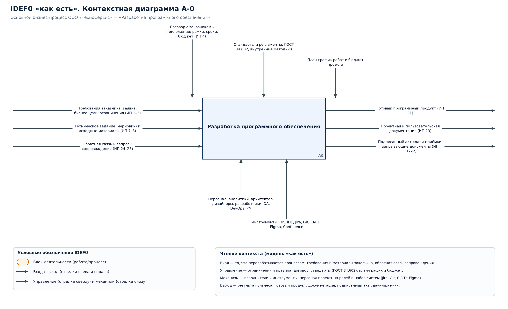

*Векторная версия: [idef0-a-minus-0.svg](../diagrams/idef0-a-minus-0.svg).*

### 2.1. Стрелки контекста (ICOM)

| Тип стрелки | Наименование | Смысл |
|---|---|---|
| Вход | Требования заказчика: заявка, бизнес-цели, ограничения (ИП 1–3) | Заказчик, сопровождающие подразделения → блок A0 |
| Вход | Техническое задание (черновик) и исходные материалы (ИП 7–8) | Заказчик, сопровождающие подразделения → блок A0 |
| Вход | Обратная связь и запросы сопровождения (ИП 24–25) | Заказчик, сопровождающие подразделения → блок A0 |
| Выход | Готовый программный продукт (ИП 21) | Блок A0 → заказчик, бухгалтерия, архив |
| Выход | Проектная и пользовательская документация (ИП 23) | Блок A0 → заказчик, бухгалтерия, архив |
| Выход | Подписанный акт сдачи-приёмки, закрывающие документы (ИП 21–22) | Блок A0 → заказчик, бухгалтерия, архив |
| Управление | Договор с заказчиком и приложения: рамки, сроки, бюджет (ИП 4) | Договор и нормативная база → ограничивают процесс |
| Управление | Стандарты и регламенты: ГОСТ 34.602, внутренние методики | Договор и нормативная база → ограничивают процесс |
| Управление | План-график работ и бюджет проекта | Договор и нормативная база → ограничивают процесс |
| Механизм | Персонал: аналитики, архитектор, дизайнеры, разработчики, QA, DevOps, PM | Персонал и инструменты, выполняющие процесс |
| Механизм | Инструменты: ПК, IDE, Jira, Git, CI/CD, Figma, Confluence | Персонал и инструменты, выполняющие процесс |

## 3. Уровень 1 — декомпозиция A0

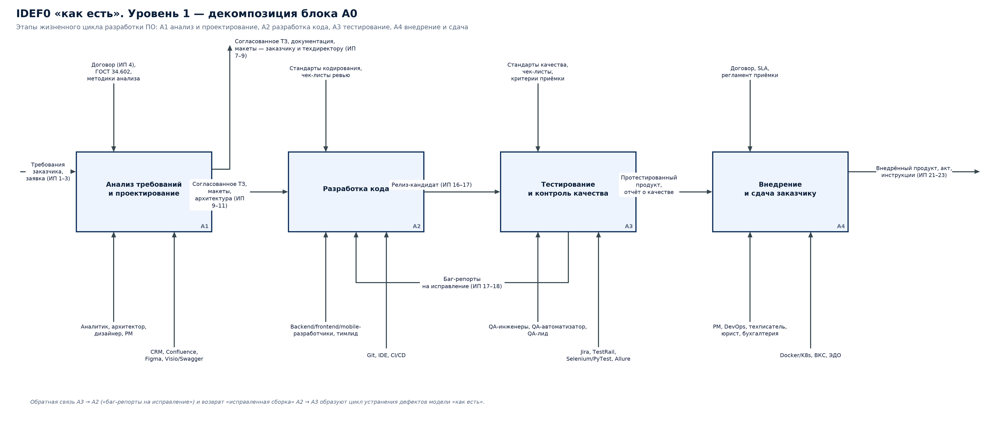

*Векторная версия: [idef0-level1.svg](../diagrams/idef0-level1.svg).*

| Узел | Наименование | Входы | Выходы | Управление | Механизмы |
|---|---|---|---|---|---|
| A1 | Анализ требований и проектирование | Требования заказчика, заявка (ИП 1–3) | Согласованное ТЗ, проектная документация, макеты (ИП 9) | Договор (ИП 4), ГОСТ 34.602, методики анализа | Аналитик, архитектор, дизайнер, PM CRM, Confluence, Figma, Visio/Swagger |
| A2 | Разработка кода | Согласованное ТЗ, архитектура, макеты | Релиз-кандидат (ИП 16) | Стандарты кодирования, чек-листы ревью | Backend/frontend/mobile- разработчики, тимлид Git, IDE, CI/CD |
| A3 | Тестирование и контроль качества | Исправленная сборка (возврат из A2) | Протестированный продукт, отчёт о качестве (ИП 19–21) | Стандарты качества, чек-листы, критерии приёмки | QA-инженеры, QA-автоматизатор, QA-лид Jira, TestRail, Selenium/PyTest, Allure |
| A4 | Внедрение и сдача заказчику | Протестированный продукт, отчёт о качестве | Внедрённый продукт, акт, инструкции (ИП 21–23) | Договор, SLA, регламент приёмки | PM, DevOps, техписатель, юрист, бухгалтерия Docker/K8s, ВКС, ЭДО |

Внутренние потоки уровня 1: A1 → A2: Согласованное ТЗ, макеты, архитектура (ИП 9–11); A2 → A3: Релиз-кандидат (ИП 16–17); A3 → A2: Баг-репорты на исправление (ИП 17–18); A3 → A4: Протестированный продукт, отчёт о качестве. Цикл A3 → A2 → A3 отражает возврат дефектов на исправление «как есть».

## 4. Уровень 2 — декомпозиции A1…A4

### 4.1. Диаграмма узла A1

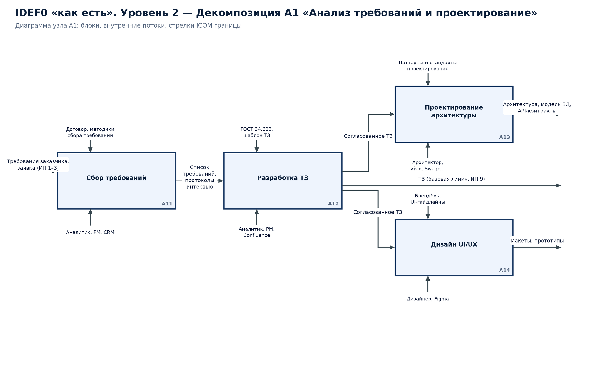

*Векторная версия: [idef0-level2-a1.svg](../diagrams/idef0-level2-a1.svg).*

| Узел | Наименование | Управление | Механизмы |
|---|---|---|---|
| A11 | Сбор требований | Договор, методики сбора требований | Аналитик, PM, CRM |
| A12 | Разработка ТЗ | ГОСТ 34.602, шаблон ТЗ | Аналитик, PM, Confluence |
| A13 | Проектирование архитектуры | Паттерны и стандарты проектирования | Архитектор, Visio, Swagger |
| A14 | Дизайн UI/UX | Брендбук, UI-гайдлайны | Дизайнер, Figma |

Потоки: A11 → A12: Список требований, протоколы интервью; A12 → A13: Согласованное ТЗ; A12 → A14: Согласованное ТЗ.

### 4.2. Диаграмма узла A2

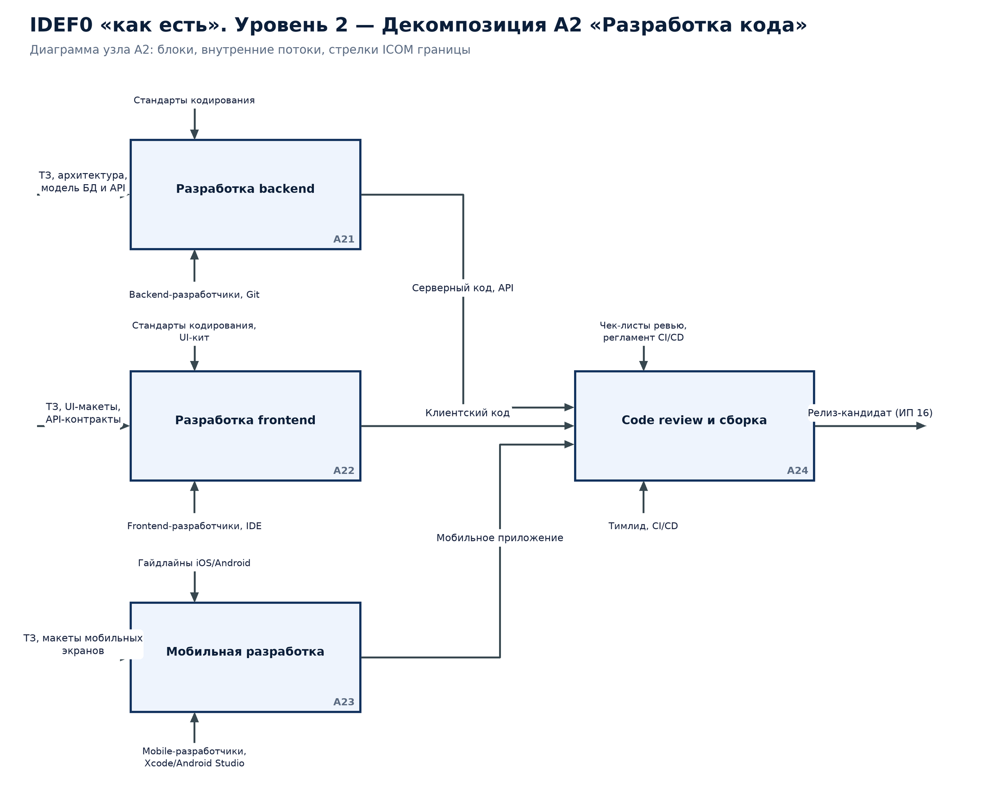

*Векторная версия: [idef0-level2-a2.svg](../diagrams/idef0-level2-a2.svg).*

| Узел | Наименование | Управление | Механизмы |
|---|---|---|---|
| A21 | Разработка backend | Стандарты кодирования | Backend-разработчики, Git |
| A22 | Разработка frontend | Стандарты кодирования, UI-кит | Frontend-разработчики, IDE |
| A23 | Мобильная разработка | Гайдлайны iOS/Android | Mobile-разработчики, Xcode/Android Studio |
| A24 | Code review и сборка | Чек-листы ревью, регламент CI/CD | Тимлид, CI/CD |

Потоки: A21 → A24: Серверный код, API; A22 → A24: Клиентский код; A23 → A24: Мобильное приложение.

### 4.3. Диаграмма узла A3

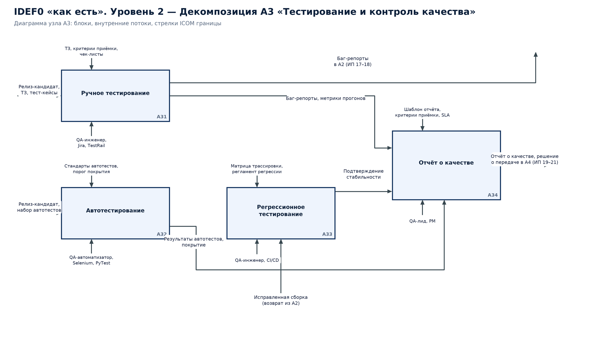

*Векторная версия: [idef0-level2-a3.svg](../diagrams/idef0-level2-a3.svg).*

| Узел | Наименование | Управление | Механизмы |
|---|---|---|---|
| A31 | Ручное тестирование | ТЗ, критерии приёмки, чек-листы | QA-инженер, Jira, TestRail |
| A32 | Автотестирование | Стандарты автотестов, порог покрытия | QA-автоматизатор, Selenium, PyTest |
| A33 | Регрессионное тестирование | Матрица трассировки, регламент регрессии | QA-инженер, CI/CD |
| A34 | Отчёт о качестве | Шаблон отчёта, критерии приёмки, SLA | QA-лид, PM |

Потоки: A31 → A34: Баг-репорты, метрики прогонов; A32 → A34: Результаты автотестов, покрытие; A33 → A34: Подтверждение стабильности.

### 4.4. Диаграмма узла A4

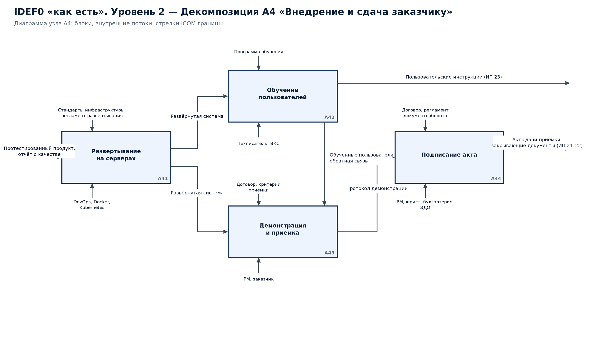

*Векторная версия: [idef0-level2-a4.svg](../diagrams/idef0-level2-a4.svg).*

| Узел | Наименование | Управление | Механизмы |
|---|---|---|---|
| A41 | Развертывание на серверах | Стандарты инфраструктуры, регламент развёртывания | DevOps, Docker, Kubernetes |
| A42 | Обучение пользователей | Программа обучения | Техписатель, ВКС |
| A43 | Демонстрация и приемка | Договор, критерии приёмки | PM, заказчик |
| A44 | Подписание акта | Договор, регламент документооборота | PM, юрист, бухгалтерия, ЭДО |

Потоки: A41 → A42: Развёрнутая система; A41 → A43: Развёрнутая система; A42 → A43: Обученные пользователи, обратная связь; A43 → A44: Протокол демонстрации.

## 5. Уровень 3 — декомпозиции A11…A44 (элементарные работы)

### 5.1. Диаграмма узла A11 «Сбор требований»

*Векторная версия: [idef0-level3-a11.svg](../diagrams/idef0-level3-a11.svg).*

Вход диаграммы: Первичная заявка и контакты заказчика (ИП 1–2). Выход диаграммы: Список требований, протоколы интервью (ИП 7).

| Узел | Элементарная работа | Управление (регламент/стандарт) | Механизм |
|---|---|---|---|
| A111 | Регистрация и анализ заявки | Регламент обработки заказов | Менеджер продаж, CRM |
| A112 | Интервью с заказчиком и стейкхолдерами | Методика интервью | Аналитик, PM, ВКС |
| A113 | Формализация требований | Шаблон реестра требований | Аналитик, Confluence |
| A114 | Нормализация и приоритизация с заказчиком | Договор, критерии приоритетов | Аналитик, заказчик |

Последовательность: A111 → A112 → A113 → A114; передаваемые объекты: Карточка заявки, контакты; Протоколы интервью; Черновик реестра требований.

### 5.2. Диаграмма узла A12 «Разработка ТЗ»

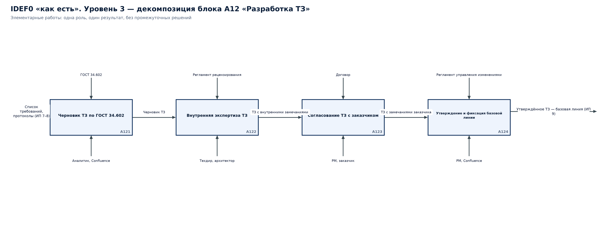

*Векторная версия: [idef0-level3-a12.svg](../diagrams/idef0-level3-a12.svg).*

Вход диаграммы: Список требований, протоколы (ИП 7–8). Выход диаграммы: Утверждённое ТЗ — базовая линия (ИП 9).

| Узел | Элементарная работа | Управление (регламент/стандарт) | Механизм |
|---|---|---|---|
| A121 | Черновик ТЗ по ГОСТ 34.602 | ГОСТ 34.602 | Аналитик, Confluence |
| A122 | Внутренняя экспертиза ТЗ | Регламент рецензирования | Техдир, архитектор |
| A123 | Согласование ТЗ с заказчиком | Договор | PM, заказчик |
| A124 | Утверждение и фиксация базовой линии | Регламент управления изменениями | PM, Confluence |

Последовательность: A121 → A122 → A123 → A124; передаваемые объекты: Черновик ТЗ; ТЗ с внутренними замечаниями; ТЗ с замечаниями заказчика.

### 5.3. Диаграмма узла A13 «Проектирование архитектуры»

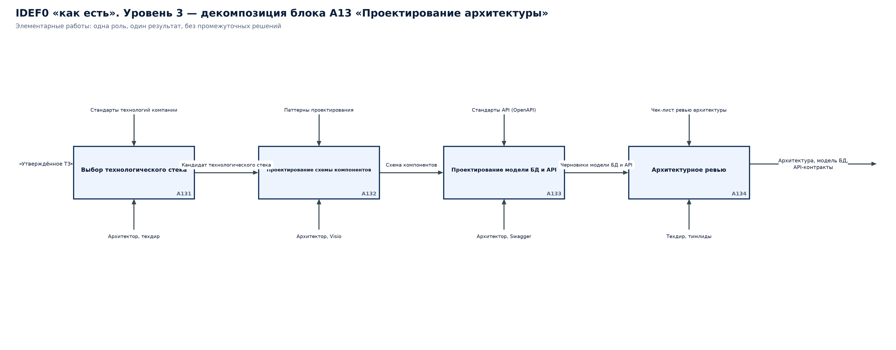

*Векторная версия: [idef0-level3-a13.svg](../diagrams/idef0-level3-a13.svg).*

Вход диаграммы: Утверждённое ТЗ. Выход диаграммы: Архитектура, модель БД, API-контракты.

| Узел | Элементарная работа | Управление (регламент/стандарт) | Механизм |
|---|---|---|---|
| A131 | Выбор технологического стека | Стандарты технологий компании | Архитектор, техдир |
| A132 | Проектирование схемы компонентов | Паттерны проектирования | Архитектор, Visio |
| A133 | Проектирование модели БД и API | Стандарты API (OpenAPI) | Архитектор, Swagger |
| A134 | Архитектурное ревью | Чек-лист ревью архитектуры | Техдир, тимлиды |

Последовательность: A131 → A132 → A133 → A134; передаваемые объекты: Кандидат технологического стека; Схема компонентов; Черновики модели БД и API.

### 5.4. Диаграмма узла A14 «Дизайн UI/UX»

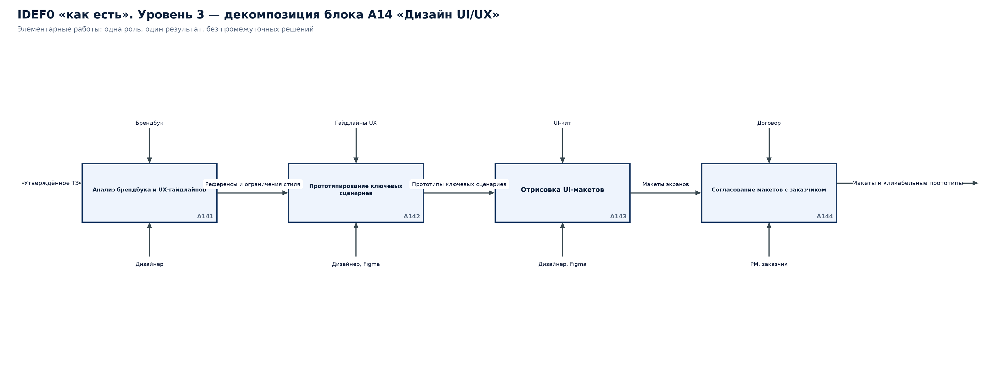

*Векторная версия: [idef0-level3-a14.svg](../diagrams/idef0-level3-a14.svg).*

Вход диаграммы: Утверждённое ТЗ. Выход диаграммы: Макеты и кликабельные прототипы.

| Узел | Элементарная работа | Управление (регламент/стандарт) | Механизм |
|---|---|---|---|
| A141 | Анализ брендбука и UX-гайдлайнов | Брендбук | Дизайнер |
| A142 | Прототипирование ключевых сценариев | Гайдлайны UX | Дизайнер, Figma |
| A143 | Отрисовка UI-макетов | UI-кит | Дизайнер, Figma |
| A144 | Согласование макетов с заказчиком | Договор | PM, заказчик |

Последовательность: A141 → A142 → A143 → A144; передаваемые объекты: Референсы и ограничения стиля; Прототипы ключевых сценариев; Макеты экранов.

### 5.5. Диаграмма узла A21 «Разработка backend»

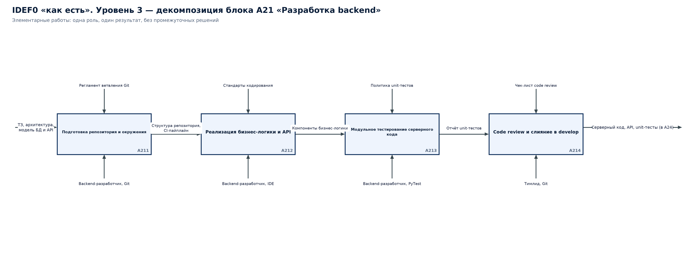

*Векторная версия: [idef0-level3-a21.svg](../diagrams/idef0-level3-a21.svg).*

Вход диаграммы: ТЗ, архитектура, модель БД и API. Выход диаграммы: Серверный код, API, unit-тесты (в A24).

| Узел | Элементарная работа | Управление (регламент/стандарт) | Механизм |
|---|---|---|---|
| A211 | Подготовка репозитория и окружения | Регламент ветвления Git | Backend-разработчик, Git |
| A212 | Реализация бизнес-логики и API | Стандарты кодирования | Backend-разработчик, IDE |
| A213 | Модульное тестирование серверного кода | Политика unit-тестов | Backend-разработчик, PyTest |
| A214 | Code review и слияние в develop | Чек-лист code review | Тимлид, Git |

Последовательность: A211 → A212 → A213 → A214; передаваемые объекты: Структура репозитория, CI-пайплайн; Компоненты бизнес-логики; Отчёт unit-тестов.

### 5.6. Диаграмма узла A22 «Разработка frontend»

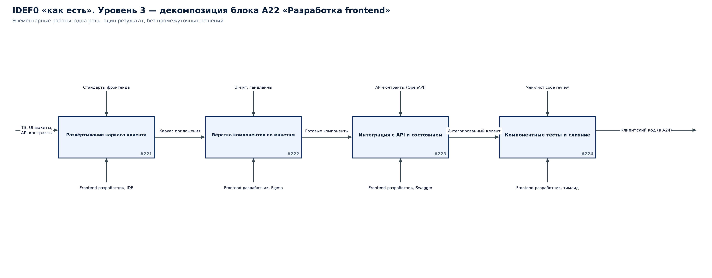

*Векторная версия: [idef0-level3-a22.svg](../diagrams/idef0-level3-a22.svg).*

Вход диаграммы: ТЗ, UI-макеты, API-контракты. Выход диаграммы: Клиентский код (в A24).

| Узел | Элементарная работа | Управление (регламент/стандарт) | Механизм |
|---|---|---|---|
| A221 | Развёртывание каркаса клиента | Стандарты фронтенда | Frontend-разработчик, IDE |
| A222 | Вёрстка компонентов по макетам | UI-кит, гайдлайны | Frontend-разработчик, Figma |
| A223 | Интеграция с API и состоянием | API-контракты (OpenAPI) | Frontend-разработчик, Swagger |
| A224 | Компонентные тесты и слияние | Чек-лист code review | Frontend-разработчик, тимлид |

Последовательность: A221 → A222 → A223 → A224; передаваемые объекты: Каркас приложения; Готовые компоненты; Интегрированный клиент.

### 5.7. Диаграмма узла A23 «Мобильная разработка»

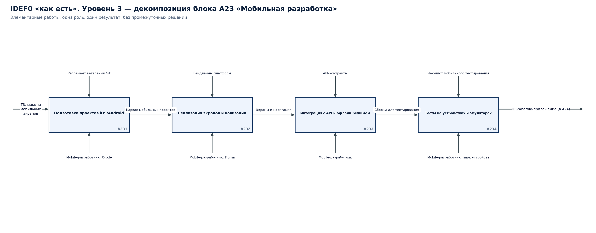

*Векторная версия: [idef0-level3-a23.svg](../diagrams/idef0-level3-a23.svg).*

Вход диаграммы: ТЗ, макеты мобильных экранов. Выход диаграммы: iOS/Android-приложение (в A24).

| Узел | Элементарная работа | Управление (регламент/стандарт) | Механизм |
|---|---|---|---|
| A231 | Подготовка проектов iOS/Android | Регламент ветвления Git | Mobile-разработчик, Xcode |
| A232 | Реализация экранов и навигации | Гайдлайны платформ | Mobile-разработчик, Figma |
| A233 | Интеграция с API и офлайн-режимом | API-контракты | Mobile-разработчик |
| A234 | Тесты на устройствах и эмуляторах | Чек-лист мобильного тестирования | Mobile-разработчик, парк устройств |

Последовательность: A231 → A232 → A233 → A234; передаваемые объекты: Каркас мобильных проектов; Экраны и навигация; Сборки для тестирования.

### 5.8. Диаграмма узла A24 «Code review и сборка»

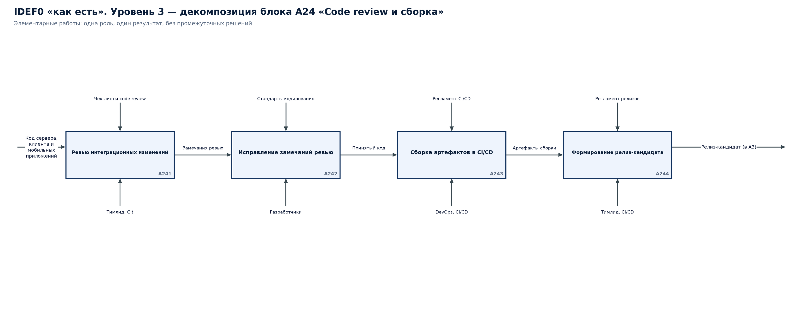

*Векторная версия: [idef0-level3-a24.svg](../diagrams/idef0-level3-a24.svg).*

Вход диаграммы: Код сервера, клиента и мобильных приложений. Выход диаграммы: Релиз-кандидат (в A3).

| Узел | Элементарная работа | Управление (регламент/стандарт) | Механизм |
|---|---|---|---|
| A241 | Ревью интеграционных изменений | Чек-листы code review | Тимлид, Git |
| A242 | Исправление замечаний ревью | Стандарты кодирования | Разработчики |
| A243 | Сборка артефактов в CI/CD | Регламент CI/CD | DevOps, CI/CD |
| A244 | Формирование релиз-кандидата | Регламент релизов | Тимлид, CI/CD |

Последовательность: A241 → A242 → A243 → A244; передаваемые объекты: Замечания ревью; Принятый код; Артефакты сборки.

### 5.9. Диаграмма узла A31 «Ручное тестирование»

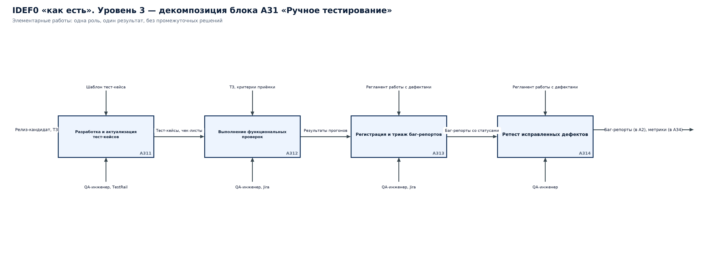

*Векторная версия: [idef0-level3-a31.svg](../diagrams/idef0-level3-a31.svg).*

Вход диаграммы: Релиз-кандидат, ТЗ. Выход диаграммы: Баг-репорты (в A2), метрики (в A34).

| Узел | Элементарная работа | Управление (регламент/стандарт) | Механизм |
|---|---|---|---|
| A311 | Разработка и актуализация тест-кейсов | Шаблон тест-кейса | QA-инженер, TestRail |
| A312 | Выполнение функциональных проверок | ТЗ, критерии приёмки | QA-инженер, Jira |
| A313 | Регистрация и триаж баг-репортов | Регламент работы с дефектами | QA-инженер, Jira |
| A314 | Ретест исправленных дефектов | Регламент работы с дефектами | QA-инженер |

Последовательность: A311 → A312 → A313 → A314; передаваемые объекты: Тест-кейсы, чек-листы; Результаты прогонов; Баг-репорты со статусами.

### 5.10. Диаграмма узла A32 «Автотестирование»

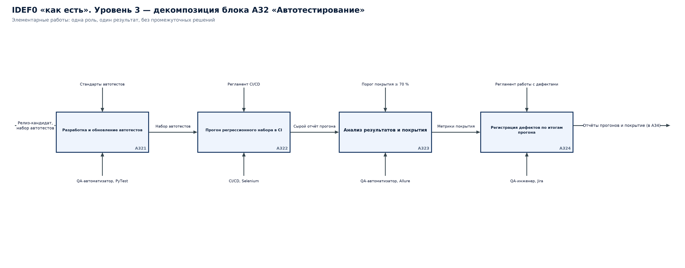

*Векторная версия: [idef0-level3-a32.svg](../diagrams/idef0-level3-a32.svg).*

Вход диаграммы: Релиз-кандидат, набор автотестов. Выход диаграммы: Отчёты прогонов и покрытие (в A34).

| Узел | Элементарная работа | Управление (регламент/стандарт) | Механизм |
|---|---|---|---|
| A321 | Разработка и обновление автотестов | Стандарты автотестов | QA-автоматизатор, PyTest |
| A322 | Прогон регрессионного набора в CI | Регламент CI/CD | CI/CD, Selenium |
| A323 | Анализ результатов и покрытия | Порог покрытия ≥ 70 % | QA-автоматизатор, Allure |
| A324 | Регистрация дефектов по итогам прогона | Регламент работы с дефектами | QA-инженер, Jira |

Последовательность: A321 → A322 → A323 → A324; передаваемые объекты: Набор автотестов; Сырой отчёт прогона; Метрики покрытия.

### 5.11. Диаграмма узла A33 «Регрессионное тестирование»

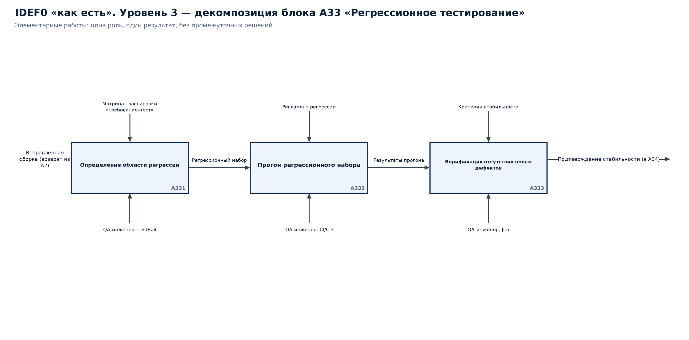

*Векторная версия: [idef0-level3-a33.svg](../diagrams/idef0-level3-a33.svg).*

Вход диаграммы: Исправленная сборка (возврат из A2). Выход диаграммы: Подтверждение стабильности (в A34).

| Узел | Элементарная работа | Управление (регламент/стандарт) | Механизм |
|---|---|---|---|
| A331 | Определение области регрессии | Матрица трассировки «требование–тест» | QA-инженер, TestRail |
| A332 | Прогон регрессионного набора | Регламент регрессии | QA-инженер, CI/CD |
| A333 | Верификация отсутствия новых дефектов | Критерии стабильности | QA-инженер, Jira |

Последовательность: A331 → A332 → A333; передаваемые объекты: Регрессионный набор; Результаты прогона.

### 5.12. Диаграмма узла A34 «Отчёт о качестве»

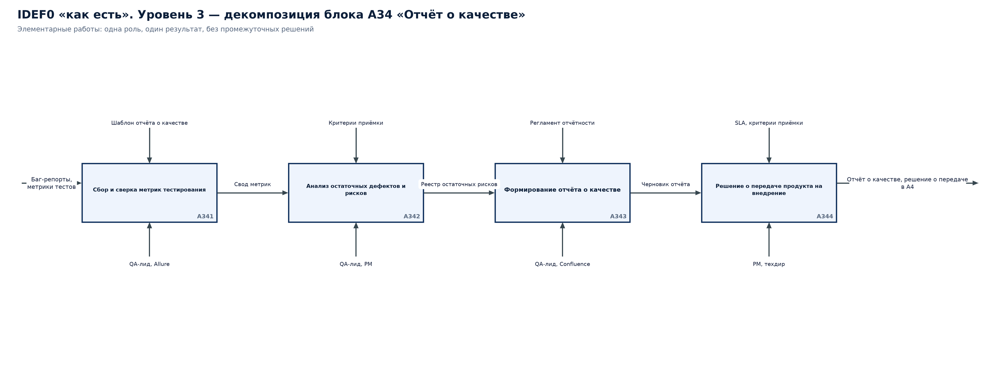

*Векторная версия: [idef0-level3-a34.svg](../diagrams/idef0-level3-a34.svg).*

Вход диаграммы: Баг-репорты, метрики тестов. Выход диаграммы: Отчёт о качестве, решение о передаче в A4.

| Узел | Элементарная работа | Управление (регламент/стандарт) | Механизм |
|---|---|---|---|
| A341 | Сбор и сверка метрик тестирования | Шаблон отчёта о качестве | QA-лид, Allure |
| A342 | Анализ остаточных дефектов и рисков | Критерии приёмки | QA-лид, PM |
| A343 | Формирование отчёта о качестве | Регламент отчётности | QA-лид, Confluence |
| A344 | Решение о передаче продукта на внедрение | SLA, критерии приёмки | PM, техдир |

Последовательность: A341 → A342 → A343 → A344; передаваемые объекты: Свод метрик; Реестр остаточных рисков; Черновик отчёта.

### 5.13. Диаграмма узла A41 «Развертывание на серверах»

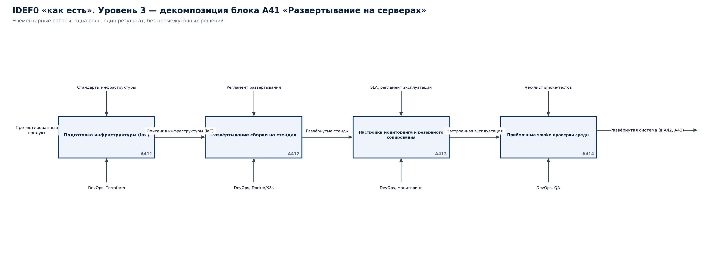

*Векторная версия: [idef0-level3-a41.svg](../diagrams/idef0-level3-a41.svg).*

Вход диаграммы: Протестированный продукт. Выход диаграммы: Развёрнутая система (в A42, A43).

| Узел | Элементарная работа | Управление (регламент/стандарт) | Механизм |
|---|---|---|---|
| A411 | Подготовка инфраструктуры (IaC) | Стандарты инфраструктуры | DevOps, Terraform |
| A412 | Развёртывание сборки на стендах | Регламент развёртывания | DevOps, Docker/K8s |
| A413 | Настройка мониторинга и резервного копирования | SLA, регламент эксплуатации | DevOps, мониторинг |
| A414 | Приёмочные smoke-проверки среды | Чек-лист smoke-тестов | DevOps, QA |

Последовательность: A411 → A412 → A413 → A414; передаваемые объекты: Описания инфраструктуры (IaC); Развёрнутые стенды; Настроенная эксплуатация.

### 5.14. Диаграмма узла A42 «Обучение пользователей»

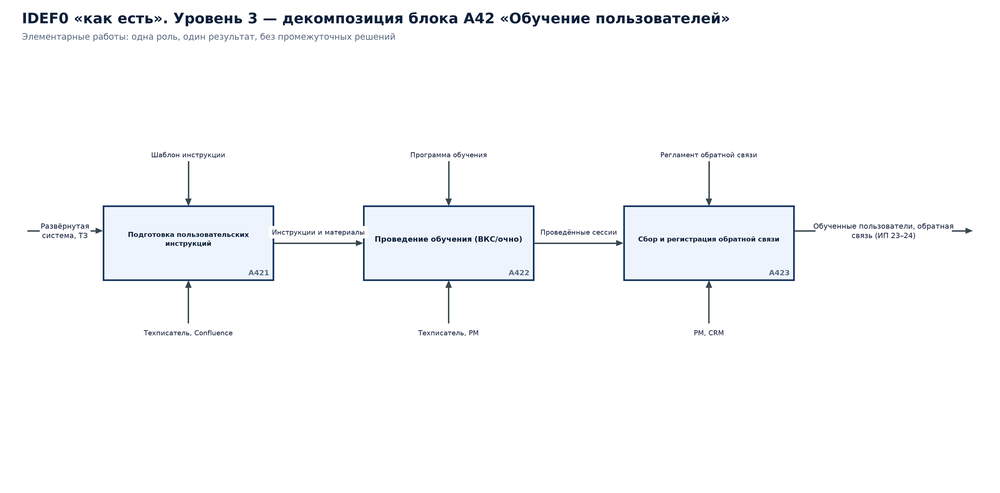

*Векторная версия: [idef0-level3-a42.svg](../diagrams/idef0-level3-a42.svg).*

Вход диаграммы: Развёрнутая система, ТЗ. Выход диаграммы: Обученные пользователи, обратная связь (ИП 23–24).

| Узел | Элементарная работа | Управление (регламент/стандарт) | Механизм |
|---|---|---|---|
| A421 | Подготовка пользовательских инструкций | Шаблон инструкции | Техписатель, Confluence |
| A422 | Проведение обучения (ВКС/очно) | Программа обучения | Техписатель, PM |
| A423 | Сбор и регистрация обратной связи | Регламент обратной связи | PM, CRM |

Последовательность: A421 → A422 → A423; передаваемые объекты: Инструкции и материалы; Проведённые сессии.

### 5.15. Диаграмма узла A43 «Демонстрация и приемка»

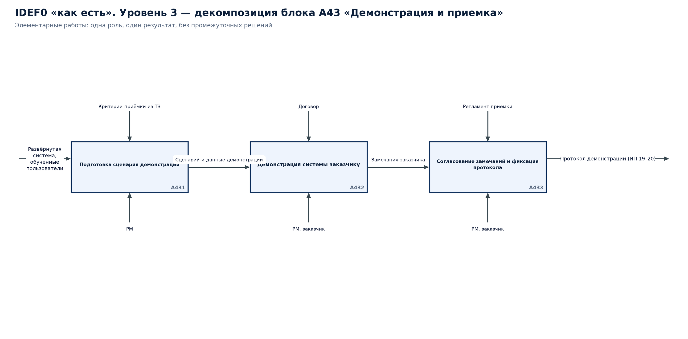

*Векторная версия: [idef0-level3-a43.svg](../diagrams/idef0-level3-a43.svg).*

Вход диаграммы: Развёрнутая система, обученные пользователи. Выход диаграммы: Протокол демонстрации (ИП 19–20).

| Узел | Элементарная работа | Управление (регламент/стандарт) | Механизм |
|---|---|---|---|
| A431 | Подготовка сценария демонстрации | Критерии приёмки из ТЗ | PM |
| A432 | Демонстрация системы заказчику | Договор | PM, заказчик |
| A433 | Согласование замечаний и фиксация протокола | Регламент приёмки | PM, заказчик |

Последовательность: A431 → A432 → A433; передаваемые объекты: Сценарий и данные демонстрации; Замечания заказчика.

### 5.16. Диаграмма узла A44 «Подписание акта»

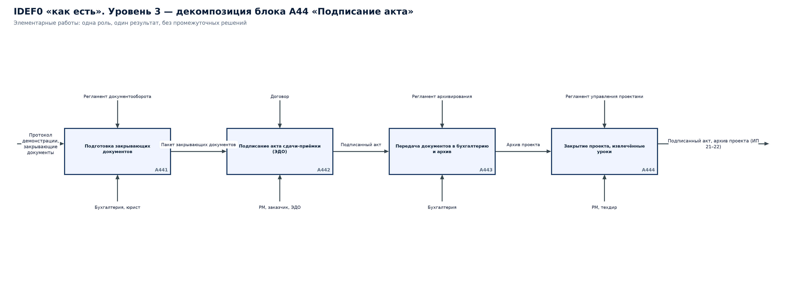

*Векторная версия: [idef0-level3-a44.svg](../diagrams/idef0-level3-a44.svg).*

Вход диаграммы: Протокол демонстрации, закрывающие документы. Выход диаграммы: Подписанный акт, архив проекта (ИП 21–22).

| Узел | Элементарная работа | Управление (регламент/стандарт) | Механизм |
|---|---|---|---|
| A441 | Подготовка закрывающих документов | Регламент документооборота | Бухгалтерия, юрист |
| A442 | Подписание акта сдачи-приёмки (ЭДО) | Договор | PM, заказчик, ЭДО |
| A443 | Передача документов в бухгалтерию и архив | Регламент архивирования | Бухгалтерия |
| A444 | Закрытие проекта, извлечённые уроки | Регламент управления проектами | PM, техдир |

Последовательность: A441 → A442 → A443 → A444; передаваемые объекты: Пакет закрывающих документов; Подписанный акт; Архив проекта.

## 6. Дерево узлов модели

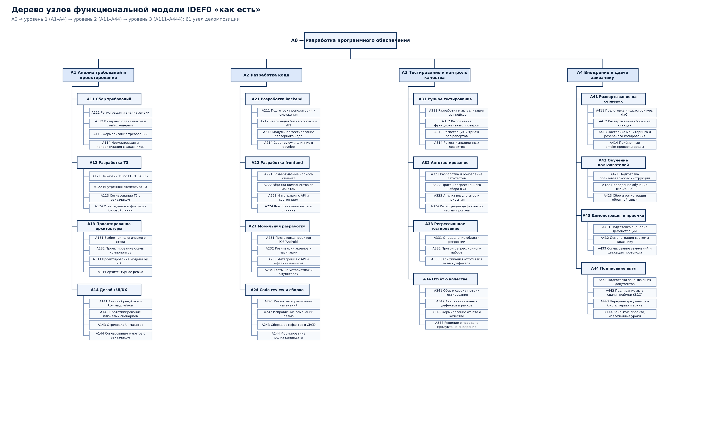

*Векторная версия: [idef0-node-tree.svg](../diagrams/idef0-node-tree.svg).*

Дерево узлов: A0; уровень 1 — A1, A2, A3, A4; уровень 2 — A11, A12, A13, A14, A21, A22, A23, A24, A31, A32, A33, A34, A41, A42, A43, A44; уровень 3 — 60 узлов A111…A444 (полный перечень в разделах 5 и на диаграмме).

## 7. Проверка синтаксиса модели

1. **Контекст.** Модель начинается контекстной диаграммой A-0 с единственным блоком A0 — основным бизнес-процессом организации; все внешние по отношению к нему элементы выражены стрелками ICOM.
2. **Число блоков.** На каждом уровне декомпозиции 3–6 блоков (на уровнях 1–3 соблюдено: 4, 4 и 3–4 блока соответственно).
3. **ICOM блока.** Каждый блок имеет не менее одного входа, выхода, управления и механизма; «чёрных дыр» (выход без входа) и «чудес» (выход без управления/механизма) нет.
4. **Нумерация.** Номера блоков назначаются по порядку слева направо и наследуют номер родителя: A1 → A11…A14 → A111…; номер указывается в правом нижнем углу блока (в Dia — поле Activity/Data identifier).
5. **Декомпозиция.** Выполнена на три уровня: уровень 1 (A1–A4), уровень 2 (A11–A44), уровень 3 (A111–A444). Глубина остановлена на элементарных работах, выполняемых одной ролью без промежуточных решений.
6. **Балансировка.** Границы входов/выходов дочерней диаграммы совпадают с входами/выходами родительского блока: например, выходы A1 (ТЗ, документация, макеты) формируются выходами блоков A12, A13, A14 диаграммы A1.
7. **Обратные связи.** Циклы исправления дефектов (A3 → A2) и возвраты на регрессию показаны явными стрелками, что соответствует модели «как есть».

## 8. Приложение. Выполнение в редакторе Dia (библиотека SADT/IDEF0)

- Диаграммы подготовлены в нотации IDEF0 и продублированы в формате редактора Dia (библиотека элементов «SADT/IDEF0», объекты «SADT - box» и «SADT - arrow»): каталог dia/ содержит по одному файлу .dia на каждую диаграмму модели (22 файла).
- В Dia блок деятельности создаётся инструментом «SADT - box»: текст блока — наименование работы, поле Activity/Data identifier — номер узла (A1, A11, A111…). Стрелки ICOM рисуются инструментом «SADT - arrow» с ортогональной трассировкой; подписи стрелок добавляются объектом «Standard - Text».
- Порядок сборки в Dia: включить панель «Sheets and Objects» → выбрать лист SADT/IDEF0 → перенести блоки согласно координатам и номерам из таблиц отчёта → соединить стрелками по спецификации потоков → подписать стрелки и проставить идентификаторы узлов.
- Файлы .dia сгенерированы программно (tools/build_dia.py) в формате Dia XML (gzip) и открываются без конвертации: объекты содержат ортогональные точки стрелок (orth_points) и идентификаторы узлов, поэтому диаграмма в Dia совпадает с SVG/PNG-версией.

Файлы Dia: `dia/idef0-a-minus-0`, `dia/idef0-level1`, `dia/idef0-level2-a1`, `dia/idef0-level2-a2`, `dia/idef0-level2-a3`, `dia/idef0-level2-a4`, `dia/idef0-level3-a11`, `dia/idef0-level3-a12`, `dia/idef0-level3-a13`, `dia/idef0-level3-a14`, `dia/idef0-level3-a21`, `dia/idef0-level3-a22`, `dia/idef0-level3-a23`, `dia/idef0-level3-a24`, `dia/idef0-level3-a31`, `dia/idef0-level3-a32`, `dia/idef0-level3-a33`, `dia/idef0-level3-a34`, `dia/idef0-level3-a41`, `dia/idef0-level3-a42`, `dia/idef0-level3-a43`, `dia/idef0-level3-a44`.
