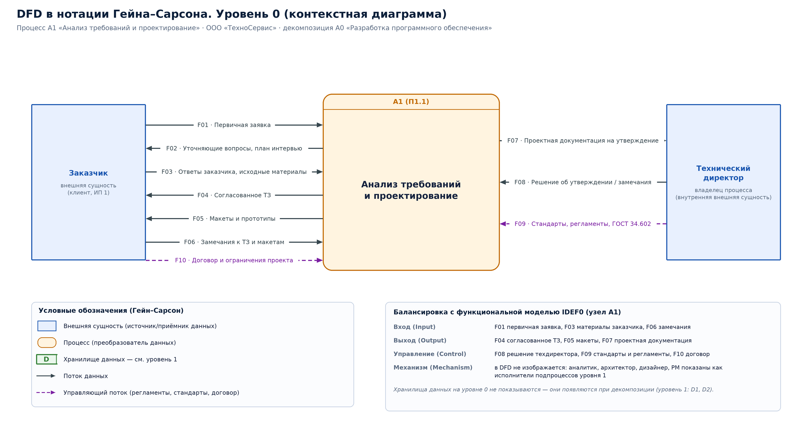
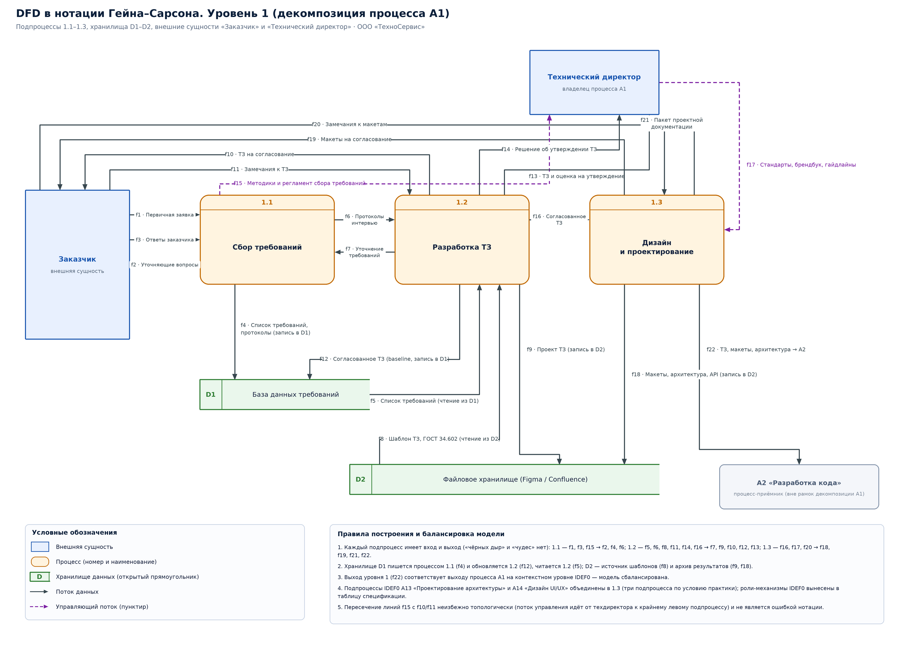

# Практика №3. Нотация DFD (диаграммы потоков данных), стандарт Гейна–Сарсона

**Объект моделирования:** ООО «ТехноСервис» (Проектирование и разработка программного обеспечения).  
**Моделируемый процесс:** A1 «Анализ требований и проектирование» (декомпозиция A0 «Разработка ПО») — узел декомпозиции A0 «Разработка программного обеспечения» функциональной модели IDEF0.

## 1. Элементы нотации Гейна–Сарсона

| Элемент | Графическое представление | Назначение в модели |
|---|---|---|
| Внешняя сущность (external entity) | Прямоугольник | Источник или приёмник данных вне границ моделируемого процесса: «Заказчик», «Технический директор» |
| Процесс (process) | Прямоугольник со скруглёнными углами, разделённый на зону номера и зону наименования | Преобразование входных потоков в выходные: A1 на уровне 0; 1.1–1.3 на уровне 1 |
| Хранилище данных (data store) | Открытый справа прямоугольник с полем идентификатора (D1, D2) | Накопитель данных, к которому процессы пишут и из которого читают (реестр требований, файловое хранилище) |
| Поток данных (data flow) | Стрелка с подписью имени потока | Перемещение данных между сущностями, процессами и хранилищами |
| Управляющий поток | Пунктирная стрелка | Регламенты, стандарты, договор — данные, ограничивающие выполнение процесса, но не преобразуемые им |

> В нотации Гейна–Сарсона процесс изображается скруглённым прямоугольником; круг/овал — эквивалентный элемент нотации Yourdon/DeMarco. Хранилище данных на контекстном уровне (уровень 0) не показывается и появляется только при декомпозиции.

## 2. Уровень 0 (контекстная диаграмма)

*Рис. — [dfd-a1-level0.svg](../diagrams/dfd-a1-level0.svg) (векторная версия для печати).*

Один процесс **«Анализ требований и проектирование»** (A1), две внешние сущности — «Заказчик» и «Технический директор» — и потоки данных, включая требуемые условием «Первичная заявка», «Согласованное ТЗ» и «Макеты».

### 2.1. Спецификация потоков данных (уровень 0)

| Код | Имя потока | Откуда | Куда | Тип | Структура данных (тип данных) | ИП* |
|---|---|---|---|---|---|---|
| F01 | Первичная заявка | Заказчик | A1 | Вход | Структурированное сообщение CRM: {ID заявки, наименование задачи, бизнес-цель, требуемые функции, сроки, бюджет, контактные лица} | ИП 1–2 |
| F02 | Уточняющие вопросы, план интервью | A1 | Заказчик | Выход | Текст (e-mail/мессенджер): список вопросов, дата и повестка интервью | ИП 3 |
| F03 | Ответы заказчика, исходные материалы | Заказчик | A1 | Вход | Текст + вложения (DOCX, XLSX, PDF): описания бизнес-процессов, примеры отчётов, доступы к системам | ИП 3 |
| F04 | Согласованное ТЗ | A1 | Заказчик | Выход | Документ по ГОСТ 34.602 (PDF/DOCX + подпись в ЭДО): {требования к функциям, к обеспечению, этапы, критерии приёмки} | ИП 7–9 |
| F05 | Макеты и прототипы | A1 | Заказчик | Выход | Графика: ссылка на проект Figma (экраны, кликабельный прототип), PDF-презентация | ИП 19–20 |
| F06 | Замечания к ТЗ и макетам | Заказчик | A1 | Вход | Текст/реестр замечаний: {ID, суть, приоритет, статус согласования} | ИП 3, 20 |
| F07 | Проектная документация на утверждение | A1 | Технический директор | Выход | Документы: архитектура (схема компонентов, модель БД, API-контракты Swagger), ТЗ, макеты, оценка трудоёмкости | ИП 9 |
| F08 | Решение об утверждении / замечания | Технический директор | A1 | Вход | Статус {«утверждено» \| «на доработку»} + текст замечаний, ограничения по стеку и ресурсам | ИП 9, 11 |
| F09 | Стандарты, регламенты, методики | Технический директор | A1 | Управление | Справочные данные: ГОСТ 34.602, внутренние стандарты проектирования, регламент согласования ТЗ, шаблоны документов | — |
| F10 | Договор и ограничения проекта | Заказчик | A1 | Управление | Документ: договор (PDF), приложения — рамки объёма работ, сроки, NDA, SLA | ИП 4 |

\* ИП — номер информационного потока из модели «как есть» (Файл 1), с которым соотносится поток DFD.

## 3. Уровень 1 (декомпозиция процесса A1)

*Рис. — [dfd-a1-level1.svg](../diagrams/dfd-a1-level1.svg) (векторная версия для печати).*

### 3.1. Подпроцессы

| № | Наименование | Исполнитель (механизм IDEF0) | Входы | Выходы | Узел IDEF0 |
|---|---|---|---|---|---|
| 1.1 | Сбор требований | Бизнес-аналитик, менеджер проекта | Первичная заявка, ответы заказчика | Список требований, протоколы интервью | A11 |
| 1.2 | Разработка ТЗ | Бизнес-аналитик, менеджер проекта | Список требований, протоколы, договор | ТЗ (согласованное и утверждённое) | A12 |
| 1.3 | Дизайн и проектирование | Архитектор, UX/UI-дизайнер | Согласованное ТЗ, брендбук | Архитектура, модель БД, API-контракты, макеты, прототипы | A13 + A14 |

### 3.2. Хранилища данных

| ID | Наименование | Физическая реализация | Состав данных |
|---|---|---|---|
| D1 | База данных требований | Jira (Components/Requirements), реестр требований Confluence | Заявки, требования с атрибутами {ID, текст, приоритет, источник, статус, версия ТЗ}, протоколы интервью, история согласований |
| D2 | Файловое хранилище (Figma / Confluence) | Figma, Confluence, Git (каталог /docs) | Версии ТЗ (DOCX/PDF), шаблоны и ГОСТ 34.602, макеты и прототипы Figma, схемы архитектуры (Visio/draw.io), OpenAPI-спецификации |

### 3.3. Спецификация потоков данных (уровень 1)

| Код | Имя потока | Откуда | Куда | Тип | Структура данных (тип данных) | ИП* |
|---|---|---|---|---|---|---|
| f1 | Первичная заявка | Заказчик | 1.1 Сбор требований | Вход | Сообщение CRM: {ID заявки, цель, функции, сроки, бюджет} | ИП 1–2 |
| f2 | Уточняющие вопросы, план интервью | 1.1 Сбор требований | Заказчик | Выход | Текст: вопросы, повестка, дата встречи | ИП 3 |
| f3 | Ответы заказчика, исходные материалы | Заказчик | 1.1 Сбор требований | Вход | Текст + вложения: описания процессов, отчёты, доступы | ИП 3 |
| f4 | Список требований, протоколы интервью | 1.1 Сбор требований | D1 База данных требований | Запись в хранилище | Записи реестра: {ID, формулировка, приоритет, источник, статус «черновик»} | ИП 7 |
| f5 | Список требований | D1 База данных требований | 1.2 Разработка ТЗ | Чтение из хранилища | Выборка записей реестра требований по проекту (атрибуты, приоритеты) | ИП 7–8 |
| f6 | Протоколы интервью, ограничения | 1.1 Сбор требований | 1.2 Разработка ТЗ | Внутренний | Документ: протокол {участники, решения, риски, ограничения} | ИП 8 |
| f7 | Запрос на уточнение требований | 1.2 Разработка ТЗ | 1.1 Сбор требований | Внутренний (обратная связь) | Текст: перечень противоречий и пробелов в требованиях | ИП 8 |
| f8 | Шаблон ТЗ, ГОСТ 34.602, регламент | D2 Файловое хранилище | 1.2 Разработка ТЗ | Чтение из хранилища | Справочные данные: шаблон документа, разделы по ГОСТ, правила нумерации | — |
| f9 | Проект ТЗ (рабочая версия) | 1.2 Разработка ТЗ | D2 Файловое хранилище | Запись в хранилище | Файл DOCX/страница Confluence + версия (v0.1…v0.n) | ИП 9 |
| f10 | ТЗ на согласование | 1.2 Разработка ТЗ | Заказчик | Выход | Документ PDF/DOCX, ссылка на страницу Confluence | ИП 19–20 |
| f11 | Замечания к ТЗ, статус согласования | Заказчик | 1.2 Разработка ТЗ | Вход | Реестр замечаний {ID, раздел ТЗ, суть, статус}, письмо о согласовании | ИП 20, 24 |
| f12 | Согласованное ТЗ (реестр требований) | 1.2 Разработка ТЗ | D1 База данных требований | Запись в хранилище | Обновление записей: статус «согласовано», версия ТЗ, базовая линия (baseline) | ИП 9 |
| f13 | ТЗ и оценка на утверждение | 1.2 Разработка ТЗ | Технический директор | Выход | Документ + оценка трудоёмкости (чел.-ч), план работ | ИП 9 |
| f14 | Решение об утверждении ТЗ | Технический директор | 1.2 Разработка ТЗ | Вход | Статус {«утверждено» \| «на доработку»}, ограничения по стеку и ресурсам | ИП 9, 11 |
| f15 | Методики сбора требований, регламент | Технический директор | 1.1 Сбор требований | Управление | Справочные данные: регламент работ с заказчиком, шаблон протокола интервью | — |
| f16 | Согласованное ТЗ | 1.2 Разработка ТЗ | 1.3 Дизайн и проектирование | Внутренний | Документ (базовая линия): функции, нефункциональные требования, ограничения | ИП 9–11 |
| f17 | Стандарты проектирования, брендбук, гайдлайны | Технический директор | 1.3 Дизайн и проектирование | Управление | Справочные данные: архитектурные паттерны, UI-кит, требования к доступности | — |
| f18 | Макеты, прототипы, схемы архитектуры, API-контракты | 1.3 Дизайн и проектирование | D2 Файловое хранилище | Запись в хранилище | Проект Figma, схемы (draw.io/Visio), спецификация OpenAPI (YAML), модель БД (DDL) | ИП 9 |
| f19 | Макеты | 1.3 Дизайн и проектирование | Заказчик | Выход | Ссылка на Figma (кликабельный прототип), PDF-презентация экранов | ИП 19–20 |
| f20 | Замечания к макетам | Заказчик | 1.3 Дизайн и проектирование | Вход | Комментарии в Figma {экран, элемент, суть}, реестр правок | ИП 20, 24 |
| f21 | Пакет проектной документации | 1.3 Дизайн и проектирование | Технический директор | Выход | Архитектура + модель БД + API-контракты + макеты: основание для постановки задач A2 | ИП 9, 11 |
| f22 | Согласованное ТЗ, макеты, архитектура | 1.3 Дизайн и проектирование | A2 «Разработка кода» (процесс-приёмник) | Выход за границу декомпозиции | Базовая линия проекта: ТЗ v1.0, макеты Figma, спецификация API, модель БД | ИП 11 |

## 4. Балансировка и проверка модели

1. Балансировка с IDEF0: входы A1 («Требования заказчика») представлены потоками f1, f3, f11, f20; выходы A1 («ТЗ, проектная документация, макеты») — потоками f4/f10/f19/f21/f22; управление («Договор, стандарты») — потоками f8, f15, f17; механизм («Аналитик, архитектор, дизайнер») в DFD не изображается — роли вынесены в атрибут `Исполнитель` подпроцессов.
2. Подпроцессы IDEF0 A13 «Проектирование архитектуры» и A14 «Дизайн UI/UX» объединены в одном процессе DFD 1.3 «Дизайн и проектирование»: по заданию практики на уровне 1 требуется три подпроцесса, а оба этих вида работ используют одно хранилище (Figma/Confluence) и одного внешнего адресата (технический директор).
3. Проверка на «чёрные дыры» и «чудеса»: у каждого подпроцесса есть хотя бы один входящий и один исходящий поток (1.1: f1,f3,f15 → f2,f4,f6; 1.2: f5,f6,f8,f11,f14,f16 → f7,f9,f10,f12,f13; 1.3: f16,f17,f20 → f18,f19,f21,f22).
4. Хранилище D1 используется в режиме «запись → чтение» (f4 → f5, f12), D2 — и как источник шаблонов (f8), и как архив результатов (f9, f18): потоки к хранилищу направлены в обе стороны, что соответствует правилам Гейна–Сарсона.
5. Процесс-приёмник «A2 Разработка кода» показан пунктирной рамкой: он лежит за границей рассматриваемой декомпозиции, но обязателен для балансировки выхода уровня 0.
