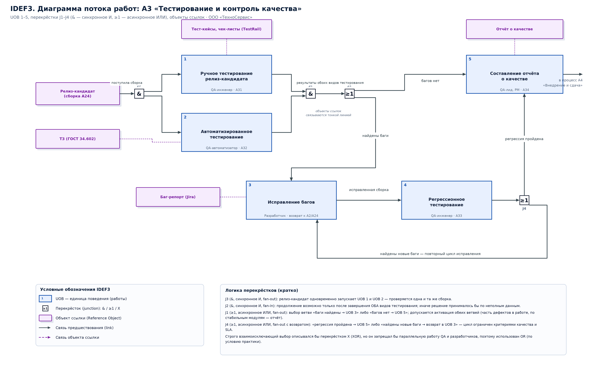

# Практика №4. Нотация IDEF3 (диаграмма потока работ, Process Flow)

**Объект моделирования:** ООО «ТехноСервис».  
**Моделируемый процесс:** A3 «Тестирование и контроль качества» — выбран потому, что содержит ветвления и циклы (возврат дефектов на исправление), которые не выражаются линейной DFD.

## 1. Элементы нотации IDEF3

| Элемент | Графика | Назначение |
|---|---|---|
| UOB (Unit of Behavior) — единица поведения | Прямоугольник с номером в левом верхнем углу | Отдельная работа процесса (ручное тестирование, исправление багов…) |
| Перекрёсток (junction) | Квадрат с символом: `&` — синхронное И, `≥1` — асинхронное ИЛИ, `X` — взаимоисключающее ИЛИ | Точка слияния (fan-in) или разветвления (fan-out) потоков работ |
| Объект ссылки (Reference Object) | Прямоугольник с «тенью» | Документ/артефакт, на который опирается работа (ТЗ, тест-кейсы, баг-репорт), связывается тонкой штриховой линией |
| Связь предшествования (link) | Стрелка | Порядок выполнения работ |

## 2. Диаграмма потока работ A3

*Рис. — [idef3-a3.svg](../diagrams/idef3-a3.svg) (векторная версия для печати).*

## 3. Спецификация единиц поведения (UOB)

| № | Наименование UOB | Исполнитель | Условие начала (триггер) | Вход | Выход | Узел IDEF0 |
|---|---|---|---|---|---|---|
| 1 | Ручное тестирование релиз-кандидата | QA-инженер (Jira, TestRail) | Завершена сборка A24 (CI/CD) | Релиз-кандидат, тест-кейсы, чек-листы | Пройденные/не пройденные тест-кейсы, баг-репорты | A31 |
| 2 | Автоматизированное тестирование | QA-автоматизатор (PyTest, Selenium) | Завершена сборка A24 (CI/CD) | Релиз-кандидат, набор автотестов | Результаты прогона (Allure/JUnit-отчёт), покрытие | A32 |
| 3 | Исправление багов | Разработчик (Git, code review A24) | Активирована ветвь «баги найдены» перекрёстка J1 | Баг-репорты со статусом «Открыт» | Исправленная сборка, комментарии в баг-репортах | A2 / A24 (возврат) |
| 4 | Регрессионное тестирование | QA-инженер + автотесты | Завершено UOB 3 | Исправленная сборка, регрессионный набор | Подтверждение стабильности либо новые баг-репорты | A33 |
| 5 | Составление отчёта о качестве | QA-лид, менеджер проекта | Багов нет (J1) либо регрессия пройдена (J4) | Результаты тестов, метрики, закрытые баг-репорты | Отчёт о качестве, решение о передаче в A4 «Внедрение и сдача» | A34 |

## 4. Перекрёстки: типы и обоснование выбора

| ID | Тип | Режим | Место в процессе | Связи | Обоснование (почему выбран именно этот тип) |
|---|---|---|---|---|---|
| J3 | Синхронное И (&) | fan-out (разветвление) | После поступления релиз-кандидата | 1 вход ← «Релиз-кандидат готов»; 2 выхода → UOB 1 и UOB 2 | Оба вида тестирования должны быть запущены по одному и тому же событию — появлению релиз-кандидата. Синхронность гарантирует, что ни одна ветвь не начнётся без активации другой: проверяется одна и та же сборка. |
| J2 | Синхронное И (&) | fan-in (слияние) | После UOB 1 и UOB 2 | 2 входа ← UOB 1, UOB 2; 1 выход → J1 | Отчёт и решение о качестве принимаются только тогда, когда завершены ОБА вида тестирования. Перекрёсток & блокирует дальнейший ход работ, пока не пришли оба входящих потока: иначе решение принималось бы по неполным данным (классическая ошибка — пропустить регрессию автотестов). |
| J1 | Асинхронное ИЛИ (≥1) | fan-out (разветвление) | После слияния результатов тестирования | 1 вход ← J2; 2 выхода → «баги найдены» (UOB 3) и «багов нет» (UOB 5) | Условие «баг найден / багов нет» — логический выбор ветви, а не ожидание событий: достаточно активации хотя бы одной ветви. Асинхронность (≥1) допускает и одновременную активацию обеих ветвей, что соответствует практике: часть дефектов уходит в исправление (UOB 3), а по стабильным модулям уже готовится сводный отчёт (UOB 5). Строго взаимоисключающий вариант описывался бы перекрёстком X (XOR), но он запрещал бы параллельную работу QA и разработчиков, поэтому по заданию выбран OR. |
| J4 | Асинхронное ИЛИ (≥1) | fan-out + возвратная связь (fan-in) | После UOB 4 «Регрессионное тестирование» | 1 вход ← UOB 4; 2 выхода → «регрессия пройдена» (UOB 5) и «найдены новые баги» (возврат в UOB 3) | Зацикливание процесса: если правка сломала ранее работавший функционал, поток возвращается в UOB 3. Перекрёсток асинхронный, потому что цикл «исправление → регрессия» может выполняться несколько раз без ожидания других ветвей; ограничение числа итераций задаётся не моделью, а SLA и критериями качества (регламент A3). |

### 4.1. Синхронность и асинхронность: правило выбора

- **Синхронный перекрёсток (`&`, И):** активация выхода возможна только после прихода **всех** входящих связей (fan-in) либо все выходы активируются **одновременно** (fan-out). Применяется там, где работы обязаны выполняться над одним и тем же объектом (релиз-кандидат) и решение принимается по полному набору результатов — J3 и J2.
- **Асинхронный перекрёсток (`≥1`, ИЛИ):** для активации достаточно **хотя бы одной** связи; ветви могут выполняться параллельно и независимо. Применяется для логических условий и циклов возврата — J1 и J4.
- **Взаимоисключающее ИЛИ (`X`, XOR)** в данной модели не используется: оно запретило бы одновременную работу ветвей «исправление дефектов» и «подготовка отчёта», что противоречит практике параллельной работы QA и разработчиков.

## 5. Объекты ссылок

| Объект ссылки | Содержание | Связан с |
|---|---|---|
| ТЗ (ГОСТ 34.602) | Эталон ожидаемого поведения системы; источник критериев приёмки для UOB 1, 4, 5 | UOB 1, UOB 4, UOB 5 |
| Релиз-кандидат (сборка) | Объект проверки, результат A24 «Code review и сборка» | J3 → UOB 1, UOB 2 |
| Тест-кейсы и чек-листы | Хранилище TestRail: сценарии, ожидаемые результаты | UOB 1, UOB 4 |
| Баг-репорт (Jira) | Дефект {шаги, ожидаемо/фактически, серьёзность, приоритет} | UOB 1, UOB 2 → J1 → UOB 3 → UOB 4 |
| Отчёт о качестве | Итоговый документ A3: метрики, остаточные риски, решение о передаче в A4 | UOB 5 → процесс A4 |

## 6. Сценарии выполнения процесса

**Сценарий 1 — «чистая сборка».** Релиз-кандидат → J3 (&) запускает UOB 1 и UOB 2 параллельно → оба завершены, J2 (&) разблокирует продолжение → J1 (≥1) активирует ветвь «багов нет» → UOB 5: отчёт о качестве, процесс A3 завершён, продукт передаётся в A4.

**Сценарий 2 — «найден дефект».** J3 (&) → UOB 1 находит баг, UOB 2 проходит → J2 (&) ждёт завершения обоих → J1 (≥1) активирует ветвь «баги найдены» → UOB 3 (разработчик исправляет) → UOB 4 (регрессия) → J4 (≥1): ветвь «регрессия пройдена» → UOB 5 → завершение.

**Сценарий 3 — «регрессия не пройдена» (цикл).** После UOB 4 перекрёсток J4 (≥1) возвращает поток в UOB 3: цикл «исправление → регрессия» повторяется до выполнения критериев качества (0 открытых дефектов серьёзности Critical/Blocker, покрытие автотестами ≥ 70 %). Модель IDEF3 допускает такое ветвление с возвратом, в отличие от линейной DFD.

