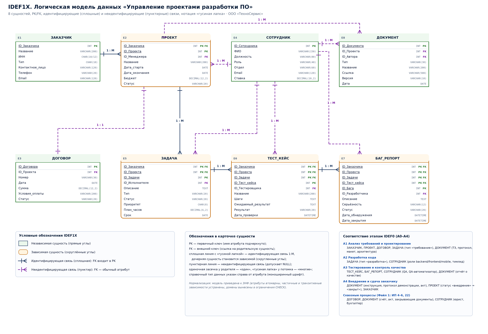

# Практики №5–6. Нотация IDEF1X (логическая модель данных)

**Предметная область:** «Управление проектами разработки ПО» ООО «ТехноСервис» — данные процессов A0–A4 функциональной модели IDEF0 и информационных потоков ИП 1–25.

## 1. Правила нотации, использованные в модели

| Правило | Как отражено на диаграмме |
|---|---|
| Независимая сущность | Прямоугольник с прямыми углами (ЗАКАЗЧИК, СОТРУДНИК, ДОГОВОР, ДОКУМЕНТ) |
| Зависимая сущность | Прямоугольник со скруглёнными углами (ПРОЕКТ, ЗАДАЧА, ТЕСТ_КЕЙС, БАГ_РЕПОРТ) — существует только через родителя |
| Идентифицирующая связь | Сплошная линия; внешний ключ родителя входит в первичный ключ потомка; «гусиная лапка» на стороне «многие» |
| Неидентифицирующая связь | Пунктирная линия; FK — обычный атрибут потомка, допускает NULL (необязательная связь) |
| Кардинальность | Одиночная засечка у родителя («один»), «гусиная лапка» у потомка («многие»); для 1:1 — засечки с обеих сторон |
| Ключи | PK подчёркнут в карточке сущности; FK помечен маркером FK; тип данных указан моноширинным шрифтом |

## 2. Диаграмма «сущность–связь»

*Рис. — [idef1x-model.svg](../diagrams/idef1x-model.svg) (векторная версия для печати).*

## 3. Перечень сущностей

| № | Сущность | Тип | Комментарий |
|---|---|---|---|
| E1 | ЗАКАЗЧИК | независимая | Независимая (independent) сущность: существует без других сущностей модели |
| E2 | ПРОЕКТ | зависимая | Зависимая (dependent) сущность: идентифицирующая связь от «Заказчик» |
| E3 | ДОГОВОР | независимая | Связь 1:1 с проектом, неидентифицирующая: у договора собственный первичный ключ |
| E4 | СОТРУДНИК | независимая | Независимая сущность: ресурс компании (механизмы IDEF0 A1…A4) |
| E5 | ЗАДАЧА | зависимая | Зависимая сущность: идентифицирующая связь от «Проект», неидентифицирующая — от «Сотрудник» (исполнитель) |
| E6 | ТЕСТ_КЕЙС | зависимая | Зависимая сущность: идентифицирующая связь от «Задача» |
| E7 | БАГ_РЕПОРТ | зависимая | Зависимая сущность: идентифицирующая связь от «Тест-кейс» |
| E8 | ДОКУМЕНТ | независимая | Неидентифицирующие связи с «Проект» и «Сотрудник»: документ хранит ссылку во внешнем хранилище (D2) и может существовать в реестре самостоятельно |

## 4. Спецификация связей

| Родитель | Потомок | Кардинальность | Тип связи | Внешний ключ (FK) | Бизнес-правило |
|---|---|---|---|---|---|
| ЗАКАЗЧИК | ПРОЕКТ | 1:M | идентифицирующая | ПРОЕКТ.ID_Заказчика | Один заказчик может иметь несколько проектов; каждый проект принадлежит ровно одному заказчику. Связь идентифицирующая: PK заказчика входит в PK проекта, сущность «ПРОЕКТ» становится зависимой (скруглённые углы). |
| ПРОЕКТ | ДОГОВОР | 1:1 | неидентифицирующая | ДОГОВОР.ID_Проекта | На каждый проект оформляется ровно один действующий договор (ИП 4). Связь неидентифицирующая: у договора собственный суррогатный PK, поэтому «ДОГОВОР» остаётся независимой сущностью (прямые углы). |
| СОТРУДНИК | ПРОЕКТ | 1:M | неидентифицирующая | ПРОЕКТ.ID_Менеджера | Сотрудник (PM) ведёт несколько проектов; проект может временно оставаться без назначенного менеджера (NULL) — связь неидентифицирующая и необязательная. |
| ПРОЕКТ | ЗАДАЧА | 1:M | идентифицирующая | ЗАДАЧА.(ID_Заказчика, ID_Проекта) | Проект декомпозируется на задачи (ИП 11); задача без проекта не существует (удаление проекта каскадно удаляет задачи) — идентифицирующая связь. |
| СОТРУДНИК | ЗАДАЧА | 1:M | неидентифицирующая | ЗАДАЧА.ID_Исполнителя | Разработчик/QA/аналитик выполняет много задач; исполнитель может быть не назначен (задача в бэклоге) и может смениться — ключ задачи при этом не меняется. |
| ЗАДАЧА | ТЕСТ_КЕЙС | 1:M | идентифицирующая | ТЕСТ_КЕЙС.(ID_Заказчика, ID_Проекта, ID_Задачи) | На задачу пишется несколько тест-кейсов (ИП 17); тест-кейс идентифицируется через задачу, поэтому связь идентифицирующая. |
| СОТРУДНИК | ТЕСТ_КЕЙС | 1:M | неидентифицирующая | ТЕСТ_КЕЙС.ID_Тестировщика | Тестировщик выполняет много проверок; для автотестов исполнитель может быть не указан (NULL). |
| ТЕСТ_КЕЙС | БАГ_РЕПОРТ | 1:M | идентифицирующая | БАГ_РЕПОРТ.(ID_Заказчика, ID_Проекта, ID_Задачи, ID_Тест_кейса) | Одна проверка может дать несколько дефектов (в т.ч. при повторных прогонах); баг-репорт не существует без тест-кейса (ИП 17–18). |
| СОТРУДНИК | БАГ_РЕПОРТ | 1:M | неидентифицирующая | БАГ_РЕПОРТ.ID_Разработчика | Разработчик исправляет множество дефектов (UOB 3 IDEF3); до назначения исполнителя значение NULL. |
| ПРОЕКТ | ДОКУМЕНТ | 1:M | неидентифицирующая | ДОКУМЕНТ.ID_Проекта | Проект сопровождается пакетом документов (ТЗ, макеты, акты, счета — ИП 4, 9, 21–23); существуют и надпроектные документы (стандарты компании) — отсюда NULL и неидентифицирующая связь. |
| СОТРУДНИК | ДОКУМЕНТ | 1:M | неидентифицирующая | ДОКУМЕНТ.ID_Автора | Сотрудник является автором многих документов; авторство может быть не определено для внешних документов (например, ГОСТ). |

## 5. Спецификация атрибутов

| Имя сущности | Имя атрибута | Тип данных | Ограничения | Описание |
|---|---|---|---|---|
| ЗАКАЗЧИК | ID_Заказчика | INT | PK, NOT NULL | Первичный ключ, автоинкремент (суррогатный ключ) |
| ЗАКАЗЧИК | Название | VARCHAR(200) | NOT NULL | Полное наименование организации или ФИО физлица |
| ЗАКАЗЧИК | ИНН | CHAR(10/12) | NULL | Идентификационный номер налогоплательщика; UNIQUE |
| ЗАКАЗЧИК | Тип | CHAR(10) | NOT NULL | Домен: {юрлицо, ИП, физлицо} |
| ЗАКАЗЧИК | Контактное_лицо | VARCHAR(120) | NULL | ФИО представителя (ИП 1, ИП 21 — подписание акта) |
| ЗАКАЗЧИК | Телефон | VARCHAR(20) | NULL | Контактный телефон |
| ЗАКАЗЧИК | Email | VARCHAR(120) | NULL | Электронная почта для документооборота (ИП 22) |
| ПРОЕКТ | ID_Заказчика | INT | PK, FK, NOT NULL | FK → ЗАКАЗЧИК.ID_Заказчика; входит в составной PK (идентифицирующая связь) |
| ПРОЕКТ | ID_Проекта | INT | PK, NOT NULL | Часть составного первичного ключа (номер проекта в рамках заказчика) |
| ПРОЕКТ | Название | VARCHAR(200) | NOT NULL | Наименование проекта (ИП 1–2) |
| ПРОЕКТ | Дата_старта | DATE | NOT NULL | Дата начала работ по договору |
| ПРОЕКТ | Дата_окончания | DATE | NULL | Плановая/фактическая дата сдачи (ИП 21) |
| ПРОЕКТ | Бюджет | DECIMAL(12,2) | NULL | Стоимость работ, RUB; CHECK (Бюджет >= 0) |
| ПРОЕКТ | Статус | VARCHAR(20) | NOT NULL | Домен: {анализ, разработка, тестирование, внедрение, закрыт} — соответствие A1…A4 |
| ПРОЕКТ | ID_Менеджера | INT | FK, NULL | FK → СОТРУДНИК.ID_Сотрудника; PM проекта (неидентифицирующая связь) |
| ДОГОВОР | ID_Договора | INT | PK, NOT NULL | Первичный ключ; номер договора в реестре юротдела (ИП 4) |
| ДОГОВОР | Номер | VARCHAR(30) | NOT NULL | Регистрационный номер, UNIQUE |
| ДОГОВОР | Дата | DATE | NOT NULL | Дата подписания |
| ДОГОВОР | ID_Проекта | INT | FK, NOT NULL | FK → ПРОЕКТ.ID_Проекта (1:1, неидентифицирующая связь) |
| ДОГОВОР | Сумма | DECIMAL(12,2) | NOT NULL | Сумма договора; основание для счёта бухгалтерии (ИП 5) |
| ДОГОВОР | Условия_оплаты | VARCHAR(200) | NULL | Предоплата/поэтапная оплата, % аванса |
| ДОГОВОР | Статус | VARCHAR(20) | NOT NULL | Домен: {проект, подписан, расторгнут, закрыт} |
| СОТРУДНИК | ID_Сотрудника | INT | PK, NOT NULL | Первичный ключ, автоинкремент |
| СОТРУДНИК | ФИО | VARCHAR(150) | NOT NULL | Фамилия, имя, отчество |
| СОТРУДНИК | Должность | VARCHAR(80) | NOT NULL | Штатная должность по оргструктуре (линейно-функциональная) |
| СОТРУДНИК | Роль | VARCHAR(40) | NOT NULL | Роль в проекте: {аналитик, архитектор, дизайнер, backend, frontend, mobile, QA, QA-автоматизатор, DevOps, PM, техписатель, юрист, бухгалтер} |
| СОТРУДНИК | Отдел | VARCHAR(60) | NOT NULL | Подчинение: {разработка, тестирование, продажи, бухгалтерия, HR} |
| СОТРУДНИК | Email | VARCHAR(120) | NOT NULL | Корпоративная почта, UNIQUE |
| СОТРУДНИК | Ставка | DECIMAL(10,2) | NULL | Оклад/часовая ставка (доступно финдиректору) |
| ЗАДАЧА | ID_Заказчика | INT | PK, FK, NOT NULL | Мигрирует из PK проекта (идентифицирующая связь ЗАКАЗЧИК→ПРОЕКТ→ЗАДАЧА) |
| ЗАДАЧА | ID_Проекта | INT | PK, FK, NOT NULL | FK → ПРОЕКТ.(ID_Заказчика, ID_Проекта); часть составного PK: задача не существует без проекта |
| ЗАДАЧА | ID_Задачи | INT | PK, NOT NULL | Часть составного PK; номер задачи в Jira (ИП 11) |
| ЗАДАЧА | Описание | TEXT | NOT NULL | Формулировка задачи / user story, критерии готовности |
| ЗАДАЧА | Тип | VARCHAR(20) | NOT NULL | Домен: {требование, разработка, тест, дефект, документ, внедрение} |
| ЗАДАЧА | Статус | VARCHAR(20) | NOT NULL | Домен: {открыта, в работе, на ревью, на тестировании, выполнена, закрыта} |
| ЗАДАЧА | Приоритет | CHAR(8) | NOT NULL | Домен: {Blocker, Critical, Major, Minor} |
| ЗАДАЧА | План_часов | DECIMAL(6,2) | NULL | Оценка трудоёмкости, чел.-ч |
| ЗАДАЧА | Срок | DATE | NULL | Плановая дата завершения (спринт) |
| ЗАДАЧА | ID_Исполнителя | INT | FK, NULL | FK → СОТРУДНИК.ID_Сотрудника; неидентифицирующая связь (исполнитель может смениться, ключ задачи от этого не меняется) |
| ТЕСТ_КЕЙС | ID_Заказчика | INT | PK, FK, NOT NULL | Мигрирует через PK задачи (цепочка идентифицирующих связей) |
| ТЕСТ_КЕЙС | ID_Проекта | INT | PK, FK, NOT NULL | Мигрирует через PK задачи |
| ТЕСТ_КЕЙС | ID_Задачи | INT | PK, FK, NOT NULL | FK → ЗАДАЧА.(ID_Заказчика, ID_Проекта, ID_Задачи); часть составного PK |
| ТЕСТ_КЕЙС | ID_Тест_кейса | INT | PK, NOT NULL | Часть составного PK; идентификатор в TestRail (ИП 17) |
| ТЕСТ_КЕЙС | Название | VARCHAR(200) | NOT NULL | Наименование проверочного сценария |
| ТЕСТ_КЕЙС | Шаги | TEXT | NULL | Последовательность шагов и тестовые данные |
| ТЕСТ_КЕЙС | Ожидаемый_результат | TEXT | NOT NULL | Эталон поведения по ТЗ |
| ТЕСТ_КЕЙС | Результат | VARCHAR(20) | NOT NULL | Домен: {не выполнялся, пройден, не пройден, заблокирован} |
| ТЕСТ_КЕЙС | ID_Тестировщика | INT | FK, NULL | FK → СОТРУДНИК.ID_Сотрудника; кто выполнял проверку |
| ТЕСТ_КЕЙС | Дата_проверки | DATETIME | NULL | Момент последнего прогона (в т.ч. автотестом, A32) |
| БАГ_РЕПОРТ | ID_Заказчика | INT | PK, FK, NOT NULL | Мигрирует через PK тест-кейса (цепочка идентифицирующих связей) |
| БАГ_РЕПОРТ | ID_Проекта | INT | PK, FK, NOT NULL | Мигрирует через PK тест-кейса |
| БАГ_РЕПОРТ | ID_Задачи | INT | PK, FK, NOT NULL | Мигрирует через PK тест-кейса |
| БАГ_РЕПОРТ | ID_Тест_кейса | INT | PK, FK, NOT NULL | FK → ТЕСТ_КЕЙС.(…); часть составного PK: дефект привязан к проверке |
| БАГ_РЕПОРТ | ID_Бага | INT | PK, NOT NULL | Часть составного PK; номер дефекта в Jira (ИП 17–18) |
| БАГ_РЕПОРТ | Описание | TEXT | NOT NULL | Фактическое поведение, шаги воспроизведения, окружение |
| БАГ_РЕПОРТ | Серьёзность | VARCHAR(12) | NOT NULL | Домен: {Blocker, Critical, Major, Minor, Trivial} |
| БАГ_РЕПОРТ | Статус | VARCHAR(20) | NOT NULL | Домен: {открыт, в работе, исправлен, на регрессии, закрыт, отклонён} |
| БАГ_РЕПОРТ | ID_Разработчика | INT | FK, NULL | FK → СОТРУДНИК.ID_Сотрудника; исполнитель исправления (UOB 3) |
| БАГ_РЕПОРТ | Дата_обнаружения | DATETIME | NOT NULL | Фиксация момента нахождения дефекта |
| БАГ_РЕПОРТ | Дата_закрытия | DATETIME | NULL | Факт закрытия после успешной регрессии (UOB 4 IDEF3) |
| ДОКУМЕНТ | ID_Документа | INT | PK, NOT NULL | Первичный ключ реестра документов |
| ДОКУМЕНТ | Тип | VARCHAR(30) | NOT NULL | Домен: {ТЗ, протокол интервью, макет, архитектура, API-спецификация, инструкция, акт, счёт, договор, отчёт о качестве} |
| ДОКУМЕНТ | Название | VARCHAR(200) | NOT NULL | Наименование документа |
| ДОКУМЕНТ | Ссылка | VARCHAR(500) | NOT NULL | URL в Confluence/Figma/Git/ЭДО (хранилище D2) |
| ДОКУМЕНТ | Версия | VARCHAR(10) | NOT NULL | Версия/ревизия документа (v1.0, v1.1) |
| ДОКУМЕНТ | Дата | DATE | NOT NULL | Дата создания или подписания |
| ДОКУМЕНТ | ID_Проекта | INT | FK, NULL | FK → ПРОЕКТ.ID_Проекта; неидентифицирующая связь (документ может быть общим, например стандарт компании) |
| ДОКУМЕНТ | ID_Автора | INT | FK, NULL | FK → СОТРУДНИК.ID_Сотрудника; автор/ответственный |

## 6. Нормализация и целостность модели

1. 1НФ: все атрибуты атомарны (списки контактов, ролей и шагов вынесены в отдельные строки или домены), составные ключи образованы только атрибутами-ссылками.
2. 2НФ: в зависимых сущностях (ПРОЕКТ, ЗАДАЧА, ТЕСТ_КЕЙС, БАГ_РЕПОРТ) неключевые атрибуты зависят от полного составного ключа, а не от его части: например «Описание» задачи определяется парой (ID_Проекта, ID_Задачи).
3. 3НФ: устранены транзитивные зависимости — «Отдел» и «Должность» сотрудника, «Тип» и «Условия_оплаты» договора, «Серьёзность» дефекта хранятся один раз; справочники доменов (статусы, роли, типы документов) при физической реализации выносятся в отдельные таблицы.
4. Идентифицирующие связи делают дочерние сущности зависимыми (скруглённые углы по стандарту IDEF1X) и обеспечивают каскадное удаление; неидентифицирующие — допускают NULL (необязательные связи) и сохраняют независимость сущности.

## 7. Соответствие модели этапам жизненного цикла (IDEF0 A0–A4)

| Этап IDEF0 | Сущности и данные этапа |
|---|---|
| A1 Анализ требований и проектирование | ЗАКАЗЧИК, ПРОЕКТ, ДОГОВОР, ЗАДАЧА (тип «требование»), ДОКУМЕНТ (ТЗ, протокол, макет, архитектура) |
| A2 Разработка кода | ЗАДАЧА (тип «разработка»), СОТРУДНИК (роли backend/frontend/mobile, тимлид) |
| A3 Тестирование и контроль качества | ТЕСТ_КЕЙС, БАГ_РЕПОРТ, СОТРУДНИК (QA, QA-автоматизатор), ДОКУМЕНТ (отчёт о качестве) |
| A4 Внедрение и сдача заказчику | ДОКУМЕНТ (инструкция, протокол демонстрации, акт), ПРОЕКТ (статус «внедрение» → «закрыт»), ЗАКАЗЧИК |
| Сквозные процессы (Файл 1: ИП 4–6, 22) | ДОГОВОР, ДОКУМЕНТ (счёт, акт, закрывающие документы), СОТРУДНИК (юрист, бухгалтер) |

## 8. Физическая реализация

Логическая модель реализована в виде DDL-скрипта PostgreSQL: [`sql/schema.sql`](../sql/schema.sql) — первичные и внешние ключи, каскадное удаление для идентифицирующих связей, `ON DELETE SET NULL` для необязательных неидентифицирующих, CHECK-ограничения доменов, индексы по FK.
